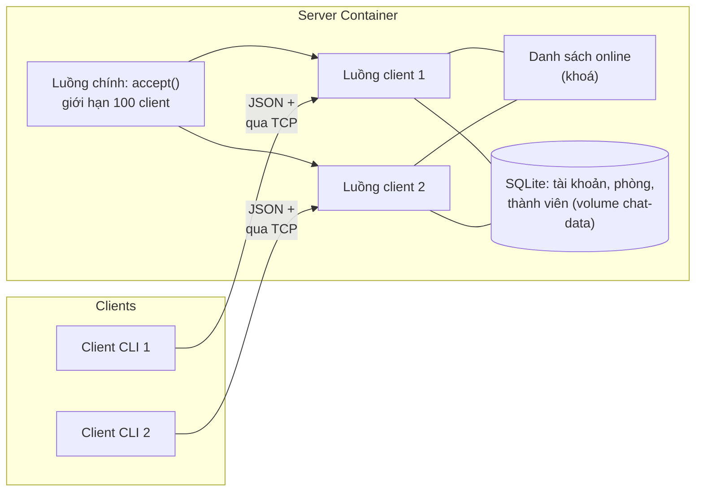

# Multi-room Chat System over TCP

> **Course:** Network Programming (INT1433) · PTIT · Instructor: Dr. Hung N. Dang

Hệ thống chat nhiều phòng tự host trong mạng nội bộ, dành cho CLB và nhóm lab nhắn tin theo phòng mà không phụ thuộc Internet và máy chủ bên thứ ba.

👋 **New here? Read first:** [`docs/student-guide.md`](docs/student-guide.md) · 📜 Brief & grading: [`INSTRUCTION.md`](INSTRUCTION.md) · 🚀 Workflow: [`GETTING_STARTED.md`](GETTING_STARTED.md)

---

## 1. Team (mandatory)

| # | Full name | Student ID | Class | GitHub | Role |
|:-:|-----------|:----------:|:-----:|--------|------|
| 1 |Hà Anh Khôi | B23DCCE056|INT1433_CLC-20261-02 | @NEWBIE1005 |Member |
| 2 |Đặng Tuấn Kiệt | B23DCCE059|INT1433_CLC-20261-02 | @ElementalHeroCodeNeos |Leader |
| 3 |Đỗ Đăng Huy |B23DCCE044 |INT1433_CLC-20261-02 | @EonPerjettDoHuy |Member |

**Topic:** 
Topic: Multi-room Chat System qua TCP
---

## 2. Problem & Idea (mandatory)

- **Problem:** 
Các nhóm nhỏ như CLB, nhóm lab hay nhóm làm đồ án cần một kênh chat theo chủ đề (phòng) và có thể chạy trong mạng nội bộ, không phụ thuộc internet và máy chủ bên thứ ba.

- **Our idea:** 
Một chat server gọn nhẹ, chạy bằng một lệnh `docker compose up` trong mạng nội bộ, giao tiếp qua giao thức tầng ứng dụng tự thiết kế trên TCP. Người dùng đăng ký bằng username và mật khẩu, tham gia nhiều phòng, nhắn tin trong phòng hoặc nhắn riêng, xem ai đang online.

- **What makes it non-trivial:**
Server phục vụ nhiều client cùng lúc theo mô hình mỗi client một luồng, nên danh sách tài khoản, người online và thành viên phòng bị nhiều luồng cùng đọc/sửa. Do đó, phải dùng khóa để tránh tranh chấp (race condition) (ví dụ hai người đăng ký cùng username) và tránh deadlock, đồng thời không để một client mạng chậm hay bị ngắt đột ngột làm ảnh hưởng client khác.

- **Out of scope:**
Gửi ảnh và tin nhắn thoại, gọi thoại/video, sửa/xoá tin, tìm kiếm tin, duyệt yêu cầu tham gia, đổi tên phòng, mã hoá đường truyền.

Full proposal: [`docs/proposal.md`](docs/proposal.md)

---

## 3. Features

- [x] **Connection & session:** đăng ký (`REGISTER`) và đăng nhập (`LOGIN`) bằng username + mật khẩu (băm `pbkdf2_hmac` + salt); mỗi tài khoản một phiên; `QUIT`; nhịp tim `PING` mỗi 30 s
- [x] **Custom protocol:** JSON một dòng trên TCP, kết thúc `
`, tối đa 64 KB; request/response/push/`ERROR`, mã trạng thái kiểu HTTP — [`docs/protocol-design.md`](docs/protocol-design.md)
- [x] **Concurrency:** mỗi client một luồng; khoá cho bộ đếm client, danh sách online, socket mỗi client, database, phòng; không giữ khoá khi gửi qua socket — [`docs/architecture.md`](docs/architecture.md)
- [x] **Robustness:** client ngắt đột ngột / bị `kill -9`, im lặng quá 90 s, gửi nhỏ giọt, dữ liệu rác, message quá 64 KB, quá 100 client (503), client không đọc (ngắt sau 5 s)
- [x] **Phòng:** xem danh sách, tạo, tham gia, rời; phòng trống tự xoá; thành viên phòng còn sau khi mất kết nối; thông báo vào/rời
- [x] **Tin nhắn:** gửi vào phòng (`ROOM_MSG`) và nhắn riêng (`PRIVATE_MSG`); danh sách người online (`LIST_ONLINE`), thành viên phòng kèm trạng thái (`LIST_MEMBERS`); thông báo online/offline
- [x] **Client CLI:** lệnh `/…`, hiển thị tin nhiều phòng với tiền tố `[phòng]`, PING nền, báo mất kết nối

Không làm (đã thu hẹp scope, xem [`docs/proposal.md`](docs/proposal.md)): gửi file, lịch sử tin nhắn, chủ phòng (mật khẩu phòng, kick), GUI.

---

## 4. Architecture



| Aspect | Our choice | Why (one line) |
|--------|-----------|----------------|
| Language | Python 3.12 (chỉ thư viện chuẩn) | Cả nhóm quen; `socket`, `threading`, `sqlite3` có sẵn |
| Transport | TCP | Chat cần tin không mất, đúng thứ tự, và biết khi client ngắt |
| Framing | delimiter: JSON một dòng kết thúc `
`, tối đa 64 KB | Đơn giản, đọc được bằng `nc`; JSON tự escape `
` trong nội dung |
| Concurrency model | thread-per-client | Vài chục client trong LAN; code tuần tự dễ lý giải; `MAX_CLIENTS=100` để từ chối bằng 503 thay vì cạn luồng |

Details: [`docs/architecture.md`](docs/architecture.md)

---

## 5. Quick Start

```bash
cp .env.example .env            # or: make init
docker compose up --build -d    # start the server   (or: make up)
docker compose run --rm client  # start a client — repeat in more terminals (or: make client)
docker compose down             # stop everything    (or: make down)
```

Trong client, gõ `/help` để xem lệnh. Ví dụ một phiên:

```
/register huy matkhau123
/login huy matkhau123
/create lab                 (hoặc /join lab nếu phòng đã có)
chào cả nhóm                (gõ chữ thường là gửi vào phòng hiện tại)
/msg kiet tối nay họp nhé   (nhắn riêng)
/online   /members lab   /rooms   /quit
```

- Khởi động sạch (xoá cả database): `docker compose down -v && docker compose up --build`.
- Windows: chạy `docker compose` trong PowerShell (trong Git Bash bị lỗi quyền khi build).
- Chạy test (trên máy, cần Python 3.12+): `python -m unittest discover tests -v`.

---

## 6. Demo & Test Evidence

Chạy ngày 2026-11-18 (chi tiết và các test khác: [`docs/testing-guide.md`](docs/testing-guide.md)).

- **Khởi động sạch:** `docker compose down -v && docker compose up --build -d` → log `Đang lắng nghe trên 0.0.0.0:5000 (tối đa 100 client)`, server tự tạo `/app/data/chat.db`; `bash scripts/smoke-test.sh` → `OK: server accepts TCP connections on localhost:5000`.
- **Nhiều client cùng lúc** (`python tests/load_test.py`, server trong Docker): `50/50 thành công trong 3.88 s`. Với 110 client: đúng 100 được phục vụ, 10 nhận `ERROR 503 "Server đã đủ 100 client, thử lại sau"`.
- **Client trong Docker:**
  ```
  Đã kết nối tới server:5000. Gõ /help để xem lệnh.
  Đã đăng ký kiet. Đăng nhập: /login kiet <mật khẩu>
  Đăng nhập thành công: kiet. Phòng của bạn: (chưa có, /rooms để xem, /join để vào)
  Đã tạo phòng lab, bạn đang ở phòng này
  [04:11] [lab] kiet: xin chao
  Đã thoát.
  ```
- **Ngắt đột ngột / kill -9:** tiến trình client bị kill → bạn cùng phòng nhận `NOTIFY_OFFLINE`, đăng nhập lại được ngay, server vẫn chạy (`tests/test_robustness.py`).
- **Test tự động:** `python -m unittest discover tests` → `Ran 165 tests`, `OK (skipped=1)`.
- **Dừng server:** `docker compose stop server` → log `Đang dừng server` (đóng socket lắng nghe khi nhận SIGTERM).

---

## 7. Documentation

| Document | Content |
|----------|---------|
| [`docs/proposal.md`](docs/proposal.md) | M1 — problem, idea, scope, plan |
| [`docs/protocol-design.md`](docs/protocol-design.md) | Application-layer protocol specification |
| [`docs/architecture.md`](docs/architecture.md) | Concurrency model, components, connection lifecycle |
| [`docs/testing-guide.md`](docs/testing-guide.md) | Test methods and our test evidence |
| [`docs/ai-log.md`](docs/ai-log.md) | AI usage log |

---

## 8. AI Disclosure (mandatory)

> Policy: [`INSTRUCTION.md` §7](INSTRUCTION.md#7-ai-usage-policy). Disclosing AI use never lowers your score — hiding it does.

### 8.1 Summary

| Tool / model | Used by | Used for | Files / modules | Level |
|--------------|---------|----------|-----------------|-------|
| *(e.g., Claude)* | *(member)* | *(e.g., draft protocol table, review locking code)* | *(paths)* | *(Assist / Co-write / Generated)* |

**Levels:** **Assist** — explanations, suggestions, review; we wrote the code. **Co-write** — AI drafted parts, we
substantially rewrote. **Generated** — AI wrote most of it; we reviewed, tested and can explain it.

### 8.2 Decisions we made ourselves

*(Key design decisions made by the team, possibly after comparing AI-suggested options. E.g., "Chose length-prefixed
framing over newline-delimited because file chunks may contain `\n`.")*

### 8.3 Where AI was wrong — and how we found out

*(At least one concrete example: a bug, wrong assumption or bad design from AI, and how you detected and fixed it.)*

### 8.4 Full log

See [`docs/ai-log.md`](docs/ai-log.md).

---

## 9. Contribution (mandatory)

| Member | Owns (modules / documents) | Key PRs / commits | AI-assisted parts | Contribution % |
|--------|----------------------------|-------------------|-------------------|:--------------:|
| | *(e.g., `server/src/session/`, `docs/architecture.md`)* | *(e.g., #3, #7)* | *(e.g., protocol parser — Co-write)* | |
| | | | | |
| | | | | |

We confirm the table above is accurate and agreed by all members:

- [ ] Member 1
- [ ] Member 2
- [ ] Member 3

---

<sub>Based on the [network-programming-starter](https://github.com/hungdn1701/network-programming-starter) template by Hung N. Dang.</sub>