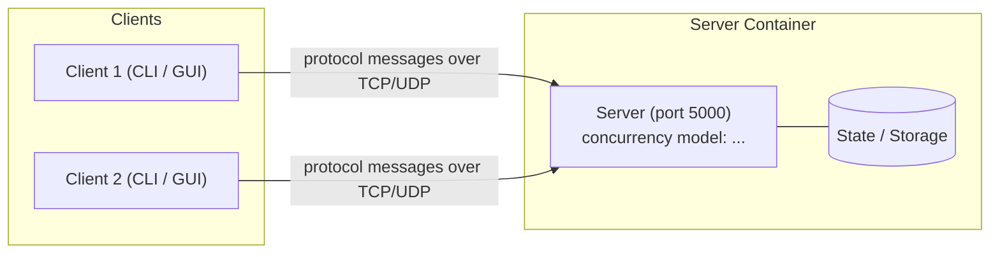

# Multi-room Chat System over TCP

> **Course:** Network Programming (INT1433) · PTIT · Instructor: Dr. Hung N. Dang

Hệ thống chat nhiều phòng tự host trong mạng nội bộ, dành cho CLB và nhóm lab nhắn tin, gửi file mà không phụ thuộc Internet và máy chủ bên thứ ba.

👋 **New here? Read first:** [`docs/student-guide.md`](docs/student-guide.md) · 📜 Brief & grading: [`INSTRUCTION.md`](INSTRUCTION.md) · 🚀 Workflow: [`GETTING_STARTED.md`](GETTING_STARTED.md)

> **Template note:** replace every *(italic placeholder)* below. Sections marked **(mandatory)** are required for grading.

---test

## 1. Team (mandatory)

| # | Full name | Student ID | Class | GitHub | Role |
|:-:|-----------|:----------:|:-----:|--------|------|
| 1 |Hà Anh Khôi | B23DCCE056|INT1433_CLC-20261-02 | @NEWBIE1005 |Member |
| 2 |Đặng Tuấn Kiệt | B23DCCE059|INT1433_CLC-20261-02 | @ElementalHeroCodeNeos |Leader |
| 3 |Đỗ Đăng Huy |B23DCCE044 |INT1433_CLC-20261-02 | @EonPerjettDoHuy |Member |

**Topic:** 
Topic: Multi-room Chat System qua TCP
---

## 2. Problem & Idea (mandatory)

- **Problem:** 
Các nhóm nhỏ như CLB, nhóm lab hay nhóm làm đồ án cần một kênh chat theo chủ đề (phòng) và có thể chạy trong mạng nội bộ, không phụ thuộc internet và máy chủ bên thứ ba.

- **Our idea:** 
Một chat server gọn nhẹ, chạy bằng một lệnh `docker compose up` trong mạng nội bộ, giao tiếp qua giao thức tầng ứng dụng tự thiết kế trên TCP. Người dùng đăng ký bằng username và mật khẩu, tham gia nhiều phòng, nhắn tin và gửi file trong phòng hoặc nhắn riêng.

- **What makes it non-trivial:**
Server phục vụ nhiều client cùng lúc theo mô hình mỗi client một luồng, nên danh sách tài khoản, người online, thành viên phòng và tin nhắn bị nhiều luồng cùng đọc/sửa. Do đó, phải dùng khóa để tránh tranh chấp (race condition) (ví dụ hai người đăng ký cùng username) và tránh deadlock, đồng thời không để một client mạng chậm hay bị ngắt đột ngột làm ảnh hưởng client khác.

- **Out of scope:**
Gửi ảnh và tin nhắn thoại, gọi thoại/video, sửa/xoá tin, tìm kiếm tin, duyệt yêu cầu tham gia, đổi tên phòng, mã hoá đường truyền.

Full proposal: [`docs/proposal.md`](docs/proposal.md)

---

## 3. Features

- [ ] **Connection & session:** *(handshake, authentication, ...)*
- [ ] **Custom protocol:** specified in [`docs/protocol-design.md`](docs/protocol-design.md)
- [ ] **Concurrency:** many clients at once, thread-safe shared state
- [ ] **Robustness:** abrupt disconnects, malformed messages, timeouts
- [ ] **Feature A:** *(short description)*
- [ ] **Feature B:** *(short description)*

---

## 4. Architecture



| Aspect | Our choice | Why (one line) |
|--------|-----------|----------------|
| Language | | |
| Transport | TCP / UDP | |
| Framing | delimiter / length-prefix / fixed | |
| Concurrency model | thread-per-client / thread pool / event loop | |

Details: [`docs/architecture.md`](docs/architecture.md)

---

## 5. Quick Start

```bash
cp .env.example .env          # or: make init
docker compose up --build -d  # start the server   (or: make up)
docker compose run --rm client  # start a client — repeat in more terminals (or: make client)
docker compose down           # stop everything    (or: make down)
```

*(Add any extra steps, e.g., running a GUI client natively.)*

---

## 6. Demo & Test Evidence

*(Screenshots or terminal output of: several clients at once, abrupt disconnect handling, your concurrency test.
Put images in `docs/asset/`. Full results: [`docs/testing-guide.md`](docs/testing-guide.md).)*

---

## 7. Documentation

| Document | Content |
|----------|---------|
| [`docs/proposal.md`](docs/proposal.md) | M1 — problem, idea, scope, plan |
| [`docs/protocol-design.md`](docs/protocol-design.md) | Application-layer protocol specification |
| [`docs/architecture.md`](docs/architecture.md) | Concurrency model, components, connection lifecycle |
| [`docs/testing-guide.md`](docs/testing-guide.md) | Test methods and our test evidence |
| [`docs/ai-log.md`](docs/ai-log.md) | AI usage log |

---

## 8. AI Disclosure (mandatory)

> Policy: [`INSTRUCTION.md` §7](INSTRUCTION.md#7-ai-usage-policy). Disclosing AI use never lowers your score — hiding it does.

### 8.1 Summary

| Tool / model | Used by | Used for | Files / modules | Level |
|--------------|---------|----------|-----------------|-------|
| *(e.g., Claude)* | *(member)* | *(e.g., draft protocol table, review locking code)* | *(paths)* | *(Assist / Co-write / Generated)* |

**Levels:** **Assist** — explanations, suggestions, review; we wrote the code. **Co-write** — AI drafted parts, we
substantially rewrote. **Generated** — AI wrote most of it; we reviewed, tested and can explain it.

### 8.2 Decisions we made ourselves

*(Key design decisions made by the team, possibly after comparing AI-suggested options. E.g., "Chose length-prefixed
framing over newline-delimited because file chunks may contain `\n`.")*

### 8.3 Where AI was wrong — and how we found out

*(At least one concrete example: a bug, wrong assumption or bad design from AI, and how you detected and fixed it.)*

### 8.4 Full log

See [`docs/ai-log.md`](docs/ai-log.md).

---

## 9. Contribution (mandatory)

| Member | Owns (modules / documents) | Key PRs / commits | AI-assisted parts | Contribution % |
|--------|----------------------------|-------------------|-------------------|:--------------:|
| | *(e.g., `server/src/session/`, `docs/architecture.md`)* | *(e.g., #3, #7)* | *(e.g., protocol parser — Co-write)* | |
| | | | | |
| | | | | |

We confirm the table above is accurate and agreed by all members:

- [ ] Member 1
- [ ] Member 2
- [ ] Member 3

---

<sub>Based on the [network-programming-starter](https://github.com/hungdn1701/network-programming-starter) template by Hung N. Dang.</sub>