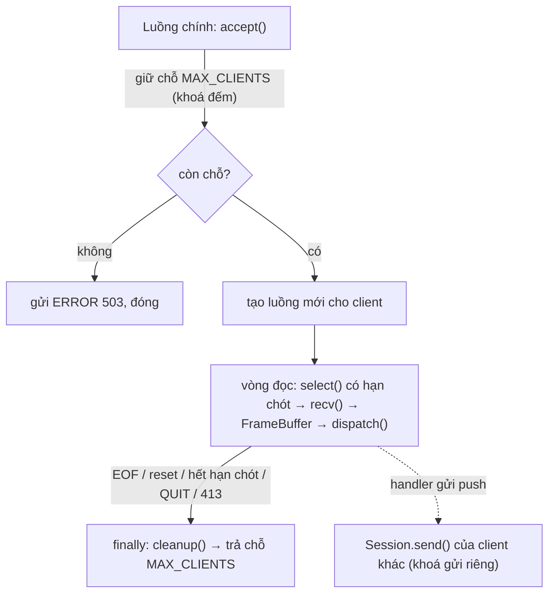
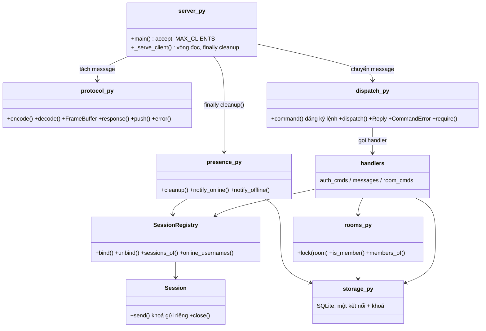

# System Architecture

> Graded under **A3 — Architecture & Concurrency Design**. Explain **what** you built and **why**.

---

## 1. Concurrency Model

**Mô hình của nhóm: mỗi client một luồng (thread-per-client), socket blocking, khoá cho dữ liệu dùng chung.**



| Model | How it works | Strengths | Weaknesses | Vì sao nhóm chọn / loại |
|-------|-------------|-----------|------------|--------------------------|
| **Thread-per-client** (chọn) | Mỗi kết nối được `accept()` có một luồng riêng, I/O blocking | Code tuần tự, dễ đọc, dễ lý giải; trọng tâm môn là đồng bộ luồng | Mỗi luồng tốn bộ nhớ; bị giới hạn số luồng của hệ điều hành | Bối cảnh vài chục client trong LAN (proposal); giới hạn `MAX_CLIENTS=100` để từ chối bằng 503 thay vì cạn luồng |
| Thread pool | K luồng cố định lấy việc từ hàng đợi | Tài nguyên có giới hạn | Với I/O blocking, K luồng chỉ phục vụ được K client; client thứ K+1 phải chờ dù chỉ ngồi đọc | Loại: chat giữ kết nối lâu, mỗi client chiếm một luồng suốt phiên |
| Event loop / asyncio | Ít luồng, nhiều socket non-blocking | Hàng nghìn kết nối với ít bộ nhớ | Khó viết hơn; một lệnh blocking làm cả server đứng; vẫn cần khoá ở đoạn "kiểm tra rồi sửa" có `await` ở giữa | Loại: thừa so với quy mô; muốn tới hàng nghìn client thì mới đổi |

**Đo thật (`docs/testing-guide.md`):** 30 client cùng đăng ký và đăng nhập (60 lần băm mật khẩu, ~0,44 s mỗi lần,
~26 s nếu chạy lần lượt) xong trong 2,47 s, vì `hashlib.pbkdf2_hmac` nhả GIL nên các luồng chạy song song.
110 client cùng kết nối: đúng 100 được phục vụ, 10 nhận 503.

**Vì sao vòng đọc dùng `select()` chứ không `settimeout()`:** timeout của socket áp cho cả đọc lẫn gửi và cho mọi
luồng dùng socket đó. Nhóm đặt cố định 5 s cho việc gửi (`SEND_TIMEOUT_SEC`), còn hạn chót đọc do `select()` lo.

**Hạn chót đọc tính theo message hoàn chỉnh:** chỉ được dời khi `FrameBuffer.feed()` trả ra ít nhất một message.
Nếu dùng `settimeout(90)` cho mỗi `recv()`, client gửi 1 byte mỗi 80 s sẽ giữ kết nối mãi (slowloris); test
`test_trickling_client_is_closed_after_timeout` chứng minh điều này.

---

## 2. Components



| Component | Responsibility | Owner (member) |
|-----------|----------------|----------------|
| `server/src/server.py` | Nhận kết nối, giới hạn `MAX_CLIENTS`, luồng mỗi client, vòng đọc có hạn chót, xử lý `ERROR` 400/413/503, `finally` gọi `cleanup()` | Kiệt |
| `shared/protocol.py` | Tách message theo `\n` (`FrameBuffer`, tối đa 64 KB), mã hoá/giải mã JSON, tạo response/push/`ERROR`; server và client cùng dùng | Kiệt |
| `server/src/dispatch.py` | Đăng ký lệnh (`@command`), kiểm tra đăng nhập và `payload`, gọi handler, gửi `<LỆNH>_RESPONSE`, chạy `Reply.after`, lỗi bất ngờ → 500 | Kiệt |
| `server/src/session.py` | `Session` (gửi có khoá riêng, gửi lỗi thì đánh dấu chết), `SessionRegistry` (danh sách online), `broadcast()` | Kiệt |
| `server/src/handlers/messages.py` | `ROOM_MSG`, `PRIVATE_MSG` | Kiệt |
| `server/src/auth.py`, `storage.py`, `presence.py`, `handlers/auth_cmds.py` | Băm mật khẩu, SQLite, dọn phiên và báo online/offline, `REGISTER`/`LOGIN`/`QUIT`/`LIST_ONLINE`/`LIST_MEMBERS` | Huy |
| `server/src/rooms.py`, `handlers/room_cmds.py` | Khoá phòng, luật phòng, lệnh phòng, thông báo vào/rời | Khôi |
| `client/` | CLI: lệnh, luồng đọc socket, PING nền, phát hiện mất kết nối, hiển thị nhiều phòng | Khôi |

---

## 3. Shared State & Thread Safety

| Shared state | Accessed by | Protection | Notes |
|--------------|-------------|-----------|-------|
| Bộ đếm số client (`server._client_count`) | Luồng chính (tăng), mọi luồng client (giảm trong `finally`) | `_client_count_lock` | "Kiểm tra < `MAX_CLIENTS` rồi tăng" nằm trọn trong khoá; không thì hai luồng cùng thấy 99 và server nhận 101 client |
| Socket của mỗi client (ghi) | Luồng của chính client (response) và luồng của người khác (push: tin nhắn, thông báo) | `Session.send_lock` (mỗi client một khoá) | Một message phải được `sendall()` liền một mạch. Không có khoá thì hai luồng ghi xen, client nhận JSON hỏng (`ManyClientsTest` kiểm tra) |
| Cờ `Session.broken` | Mọi luồng gửi tới client đó | Đọc/ghi trong `send_lock` | Gửi lỗi hoặc quá 5 s: đánh dấu chết, `shutdown` socket (không `close`, vì luồng đọc của client đó có thể đang chờ trên socket) để luồng đọc tự thức dậy và `cleanup()` |
| Danh sách online (`SessionRegistry._by_name`) | `LOGIN` (`bind`), `cleanup` (`unbind`), `broadcast`, `PRIVATE_MSG`, `LIST_ONLINE` | `SessionRegistry._lock` | `bind`: "đã online chưa" và "gắn" trong cùng khoá, nên hai `LOGIN` cùng tài khoản cùng lúc chỉ một cái thành công. `unbind` chỉ gỡ khi đúng phiên. Mọi hàm đọc trả **bản sao** |
| Kết nối SQLite (`storage._conn`) | Mọi handler, `cleanup` | `storage._lock` (một kết nối chung + một khoá, cả đọc lẫn ghi) | Trùng username/tên phòng chặn bằng `PRIMARY KEY` ngay lúc ghi, không "kiểm tra rồi ghi". Nhiều câu SQL liên quan nằm trong một giao dịch (`with conn:`) |
| Phòng và thành viên phòng | `ROOM_MSG`, lệnh phòng, `cleanup` | *(Khôi bổ sung ở bước 18: khoá phòng `rooms.lock`)* | |
| Bảng lệnh của dispatcher (`dispatch._commands`) | Mọi luồng client (đọc) | Không cần khoá | Chỉ ghi lúc import, trước khi server nhận client đầu tiên; sau đó chỉ đọc. Đăng ký trùng tên → `RuntimeError` lúc khởi động |

### 3.1 Thứ tự khoá (chống deadlock)

```
khoá phòng (rooms.lock)            ← ngoài cùng
  └─ khoá database (storage._lock)   hoặc   khoá registry (SessionRegistry._lock)   ← trong cùng, không giữ cả hai cùng lúc
Session.send_lock                  ← chỉ lấy khi KHÔNG giữ khoá dữ liệu chung nào
```

- Trong khoá database và khoá registry không gọi hàm nào lấy khoá khác, nên không có vòng chờ.
- **Không giữ khoá dữ liệu chung nào khi gửi qua socket.** `broadcast()` chép danh sách phiên trong khoá registry, nhả
  khoá, rồi mới gửi. Một client đứng hình chỉ làm người gửi chờ tối đa 5 s, không làm treo cả phòng hay cả server.
- `ROOM_MSG`: trong khoá phòng kiểm tra phòng còn tồn tại, người gửi là thành viên, chép danh sách thành viên; nhả
  khoá; gửi `ROOM_MSG_RESPONSE`, rồi mới gửi `NOTIFY_ROOM_MSG` (qua `Reply.after`).

### 3.2 Đánh đổi: thứ tự tin nhắn

Hai người cùng nhắn vào một phòng thì các người nhận có thể thấy hai tin theo **thứ tự khác nhau**: hai luồng gửi song
song sau khi đã nhả khoá phòng. Muốn mọi người thấy cùng thứ tự thì phải gửi trong khoá phòng, và một client đứng hình
làm cả phòng treo tới 5 s mỗi tin. Nhóm chọn độ trễ thấp hơn thứ tự nhất quán.

Tương tự, nếu một người ngắt rồi đăng nhập lại rất nhanh, bạn cùng phòng có thể nhận `NOTIFY_ONLINE` (luồng mới) trước
`NOTIFY_OFFLINE` (luồng cũ đang dọn phiên).

---

## 4. Connection Lifecycle

```mermaid
stateDiagram-v2
    [*] --> Connected : accept() + còn chỗ MAX_CLIENTS
    [*] --> Rejected : đủ MAX_CLIENTS → ERROR 503
    Rejected --> [*]
    Connected --> Authenticated : LOGIN 200 (registry.bind)
    Connected --> Connected : REGISTER, PING, LOGIN lỗi, lệnh khác → 401
    Authenticated --> Authenticated : lệnh, PING
    Connected --> Closing : QUIT / EOF / reset / im lặng 90 s / 413
    Authenticated --> Closing : QUIT / EOF / reset / im lặng 90 s / 413 / gửi tới client thất bại
    Closing --> Closed : cleanup() — unbind, báo offline, close socket; trả chỗ MAX_CLIENTS
    Closed --> [*]
```



| Kết thúc | Server phát hiện thế nào | Dọn gì |
|----------|--------------------------|--------|
| `QUIT` | Handler trả `Reply(close=True)`: gửi `QUIT_RESPONSE` rồi thoát vòng đọc; message sau `QUIT` bị bỏ qua | Mọi trường hợp đều đi qua **cùng một** `finally` → `cleanup(session)`: nếu đã đăng nhập thì `unbind`; chỉ khi `unbind` trả True mới báo `NOTIFY_OFFLINE` cho bạn cùng phòng; luôn đóng socket; rồi trả chỗ `MAX_CLIENTS` |
| Client đóng (FIN) | `recv()` trả `b""` (EOF) | (như trên) |
| `kill -9`, rút mạng có RST | `recv()` ném `ConnectionResetError` | (như trên) |
| Im lặng (treo, mất mạng không có FIN/RST) | Không nhận đủ message nào trong `READ_TIMEOUT_SEC` (90 s); client gửi `PING` mỗi 30 s để không bị ngắt nhầm | (như trên) |
| Gửi rác không có `\n` | Bộ đệm quá 64 KB → `ERROR 413`, `shutdown(SHUT_WR)`, đọc bỏ tối đa 1 s rồi đóng (để client nhận được 413 thay vì RST) | (như trên) |
| Client không đọc (bộ đệm gửi đầy) | `sendall()` quá 5 s → `Session` đánh dấu chết và `shutdown`; luồng đọc của client đó thức dậy (EOF) | (như trên) |
| Lỗi bất ngờ trong luồng client | `except Exception` bọc cả vòng đọc, ghi log | (như trên); chỉ client đó bị ngắt, server không sập |

Lỗi bất ngờ **trong một handler** thì khác: dispatcher trả `<LỆNH>_RESPONSE` 500, ghi log, và giữ kết nối.

---

## 5. Deployment

*(Huy viết — phần triển khai, xem `huy-context.md` mục 1.)*

| Container | Image / language | Port | Configuration |
|-----------|------------------|------|---------------|
| `server` | | 5000 | `SERVER_HOST`, `SERVER_PORT` |
| `client` | | — | `CLIENT_TARGET_HOST`, `CLIENT_TARGET_PORT` |

---

## 6. Design Decisions

| Decision | Alternatives considered | Why we chose this |
|----------|------------------------|-------------------|
| Thread-per-client | Thread pool, asyncio | Quy mô vài chục client; code tuần tự dễ lý giải; trọng tâm môn là đồng bộ luồng (mục 1) |
| Mỗi client một khoá gửi | Một khoá gửi chung; một luồng ghi riêng + hàng đợi cho mỗi client | Khoá chung làm mọi người chờ nhau; luồng ghi riêng gấp đôi số luồng. Khoá riêng: chỉ người gửi tới cùng một client mới chờ nhau |
| Gửi lỗi một lần là ngắt client | Thử gửi lại | `sendall()` hết giờ có thể đã gửi dở một phần message, luồng dữ liệu tới client đó đã hỏng |
| `shutdown` thay vì `close` khi gửi lỗi | `close` ngay | Luồng đọc của client đó có thể đang chờ trên socket; `shutdown` đánh thức nó để nó tự `cleanup()` (trên Linux; trên Windows `shutdown` không đánh thức, nhưng server chạy Linux trong Docker) |
| Không giữ khoá khi gửi qua socket | Gửi trong khoá phòng (thứ tự nhất quán) | Một client đứng hình không làm treo cả phòng; đánh đổi ở 3.2 |
| `select()` + hạn chót theo message hoàn chỉnh | `settimeout(90)` cho mỗi `recv()` | Chống client gửi nhỏ giọt giữ kết nối mãi; timeout socket dành cho việc gửi (mục 1) |
| Một kết nối SQLite + một khoá | Mỗi lần một kết nối; mỗi luồng một kết nối | Đơn giản, không gặp `database is locked`; mỗi thao tác vài mili giây nên chạy lần lượt vẫn đủ nhanh |
| Mỗi tài khoản một phiên, đăng nhập mới bị 409 | Thay phiên cũ | Tránh tranh chấp giữa luồng cũ đang dọn và luồng mới; đánh đổi: client cũ treo thì chờ tối đa 90 s |
| `cleanup()` duy nhất cho mọi kiểu kết thúc | Mỗi kiểu một đoạn dọn riêng | Không sót, không lệch nhau; nằm trong `finally` nên luôn chạy |
