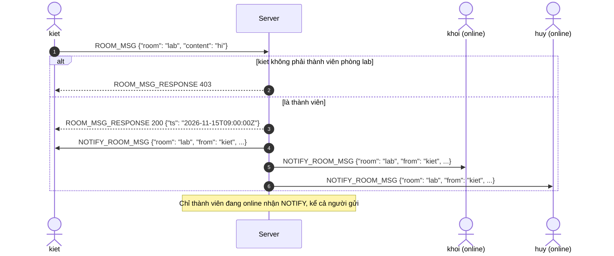
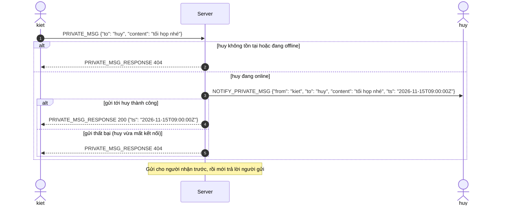
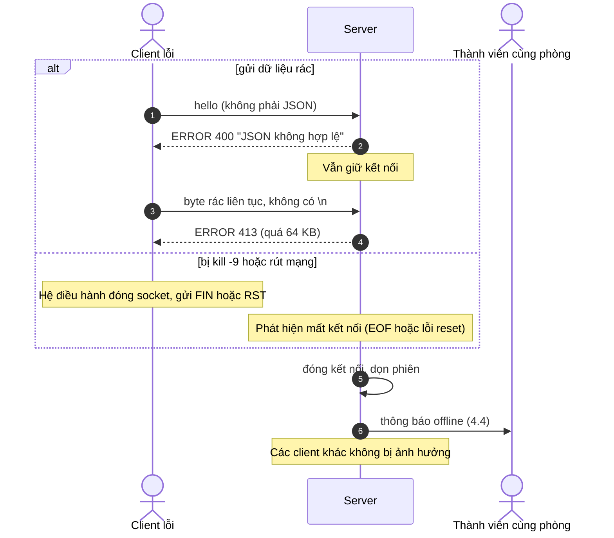

# Application Protocol Specification
 
---
 
## 1. Overview
 
| Property | Our choice | Why |
|----------|-----------|-----|
| **Protocol name / version** | MRCP/1.0 (Multi-Room Chat Protocol) | Phiên bản chỉ ghi trong tài liệu, không gửi trên đường truyền |
| **Transport** | TCP | Tin cậy, đúng thứ tự (reliable, ordered); server biết khi nào client ngắt kết nối |
| **Default port** | 5000 |  |
| **Message framing** | Phân tách bằng ký tự \n (delimiter-based), tối đa 64 KB | Đơn giản, đọc được bằng nc |
| **Data format** | JSON, mỗi message là một object trên một dòng | JSON tự mã hoá \n trong nội dung |
| **Session model** | Có trạng thái (stateful): server nhớ người dùng đã đăng nhập theo từng kết nối TCP | Không cần gửi token mỗi lệnh; server cần giữ kết nối để đẩy tin |
| **Character encoding** | UTF-8 | Hỗ trợ tiếng việt |
 
---
 
## 2. Message Framing
 
TCP là luồng byte (byte stream): một lần send() có thể đến thành nhiều lần recv(), và nhiều lần send() có thể đến trong một lần recv(). Bên nhận phải tự ghép lại thành từng message.  
 
**Lựa chọn của nhóm:** Phân tách bằng ký tự xuống dòng (delimiter-based).
```text
<một object JSON, mã hoá UTF-8>\n
```
- Mỗi message là một object JSON trên một dòng, kết thúc bằng đúng một byte \n (0x0A). Không gửi JSON nhiều dòng (pretty-print).
- Xuống dòng trong nội dung chuỗi thì JSON tự mã hoá thành hai ký tự \ và n, nên byte 0x0A chỉ xuất hiện ở cuối message, không cắt nhầm nội dung tin.
- Bên nhận giữ một bộ đệm (buffer) cho mỗi kết nối: nối dữ liệu mỗi lần recv() vào bộ đệm, cắt ra từng message tại mỗi \n, phần dữ liệu còn lại chờ lần recv() tiếp theo.
Ví dụ: một message bị cắt đôi và hai message dính nhau
```text
recv #1: {"command":"PING","payload":{}}\n{"command":"ROOM_MS  
recv #2: G","payload":{"room":"lab","content":"hi"}}\n  
 
Sau recv #1: tách được message lệnh PING; phần {"command":"ROOM_MS nằm lại trong bộ đệm.  
Sau recv #2: bộ đệm có đủ đến \n, tách được message lệnh ROOM_MSG.  
```
 
**Kích thước tối đa:** 64 KB (tính theo byte sau mã hoá UTF-8).  
Bộ đệm vượt 64 KB mà chưa gặp \n -> server gửi ERROR mã 413 rồi đóng kết nối, để không bị cạn bộ nhớ khi client gửi dữ liệu rác liên tục.
 
---
 
## 3. Message Format
### 3.1. Các loại message
 
| Loại | Chiều | Tên lệnh | Ví dụ |
|-------|:-----:|----------|---------|
| Yêu cầu (request) | C->S | tên lệnh | LOGIN, ROOM_MSG |
| Phản hồi (response) | S->C | <LỆNH>_RESPONSE | LOGIN_RESPONSE |
| Thông báo đẩy (push) | S->C | NOTIFY_*| NOTIFY_ROOM_MSG |
| Lỗi không gắn với lệnh nào | S->C | ERROR | JSON hỏng, lệnh lạ, quá 64 KB |
| Nhịp tim (heartbeat) | C->S, S->C | PING → PING_RESPONSE | Request/response bình thường, không có lệnh PONG riêng; client gửi mỗi 30 s (8.5) |
 
### 3.2. Yêu cầu (request)
{"command": "ROOM_MSG", "requestId": "7", "payload": {"room": "lab", "content": "Chào cả nhóm"}}
 
| Trường | Kiểu | Bắt buộc | Ý nghĩa |
|--------|:-----:|---------|---------|
| command | string | có | Tên lệnh |
| requestId | string | không | Mã request (client đặt). Server chép giá trị này vào response, để client biết response đó trả lời cho request nào. Có mà không phải chuỗi (ví dụ số `7`) → `ERROR` 400 |
| payload | object | có | Các tham số của lệnh (có thể là object rỗng {}). Thiếu hoặc không phải object → `<LỆNH>_RESPONSE` 400 (kể cả `PING`: phải gửi `"payload":{}`) |
 
### 3.3. Phản hồi (response)
{"command": "ROOM_MSG_RESPONSE", "requestId": "7", "code": 200, "message": "OK", "data": {"ts": "2026-11-15T09:00:00Z"}}
 
| Trường | Kiểu | Ý nghĩa |
|--------|:-----:|---------|
| command | string | <LỆNH>_RESPONSE | 
| requestId | string | Chép từ request (nếu có) |
| code | int | Mã trạng thái | 
| message | string | Một câu ngắn mô tả kết quả (ví dụ: Sai username hoặc mật khẩu) | 
| data | object | kết quả trả về (khi lỗi thì object rỗng {}) | 
 
### 3.4. Thông báo đẩy (push) và ERROR
{"command": "NOTIFY_ROOM_MSG", "data": {"room": "lab", "from": "khoi", "content": "Chào cả nhóm", "ts": "2026-11-15T09:00:00Z"}}
 
{"command": "ERROR", "code": 400, "message": "JSON không hợp lệ"}
 
- Thông báo đẩy (push): server chủ động gửi khi có sự kiện phát sinh (ví dụ: tin nhắn mới trong phòng), không gắn với yêu cầu nào của client nhận.
- ERROR: 
    + Không xác định được lệnh: message không phải JSON hợp lệ, thiếu trường command, command không có trong danh sách lệnh, hoặc requestId không phải chuỗi.
    + message vượt quá 64 KB (sau khi gửi ERROR, server đóng kết nối).
    + Server đã đủ số client tối đa
---
 
## 4. Command Reference
### 4.1. Kết nối và phiên (Huy; ERROR: Kiệt)
 
<!-- Huy viết: REGISTER, LOGIN, PING (server trả PING_RESPONSE, không có PONG), QUIT -->
 
| Lệnh | Chiều | Trường dữ liệu | Phản hồi | Mô tả |
|------|:-----:|----------------|----------|-------|
| `ERROR` | S → C | `code`, `message` | — | Báo lỗi message không xác định được lệnh, message vượt quá 64 KB, hoặc server đã đủ số client tối đa |
 
### 4.2. Tin nhắn (Kiệt)
 
| Lệnh | Chiều | Trường dữ liệu | Phản hồi | Mô tả |
|------|:-----:|----------------|----------|-------|
| `ROOM_MSG` | C → S | `room`, `content` | `ROOM_MSG_RESPONSE` 200 -> `ts`/400/403/404/413 | Gửi tin nhắn vào phòng |
| `NOTIFY_ROOM_MSG` | S → C | `room`, `from`, `content`, `ts` | — | Tin mới trong phòng, gửi tới mọi thành viên đang online, kể cả người gửi |
| `PRIVATE_MSG` | C → S | `to`, `content` | `PRIVATE_MSG_RESPONSE` 200 -> `ts`/400 (gồm cả gửi cho chính mình)/404 (người nhận không tồn tại hoặc đang offline)/413 | Nhắn tin riêng; chỉ gửi được khi người nhận đang online. Server gửi `NOTIFY_PRIVATE_MSG` cho người nhận **trước**, gửi được mới trả 200; gửi thất bại (người nhận vừa mất kết nối) thì trả 404 |
| `NOTIFY_PRIVATE_MSG` | S → C | `from`, `to`, `content`, `ts` | — | Tin nhắn riêng mới, gửi tới người nhận |

- `ts`: thời điểm server nhận tin, theo ISO 8601 giờ UTC, chính xác đến giây (ví dụ `2026-11-15T09:00:00Z`). Server tạo `ts`, client không gửi; response và các push của cùng một tin dùng chung một `ts`.
- `content`: 1–2.000 ký tự; chỉ có khoảng trắng thì coi là rỗng (400). Server chuyển nguyên văn, không cắt khoảng trắng.
- `ROOM_MSG`: người gửi luôn nhận `ROOM_MSG_RESPONSE` trước `NOTIFY_ROOM_MSG` của chính tin đó. Khi hai người cùng nhắn vào một phòng, các người nhận có thể thấy hai tin theo thứ tự khác nhau (xem `architecture.md`).
 
### 4.3. Phòng (Khôi)
 
<!-- Các lệnh đã thống nhất trong proposal: LIST_ROOMS, CREATE_ROOM, JOIN_ROOM, LEAVE_ROOM, ... -->
 
| Lệnh | Chiều | Trường dữ liệu | Phản hồi | Mô tả |
|------|:-----:|----------------|----------|-------|
| | | | | |
 
### 4.4. Danh sách online, thông báo vào/rời (Huy)
 
| Lệnh | Chiều | Trường dữ liệu | Phản hồi | Mô tả |
|------|:-----:|----------------|----------|-------|
| | | | | |
 
---
 
## 5. Status Codes & Errors
 
| Mã | Tên | Ý nghĩa trong hệ thống |
|:--:|-----|------------------------|
| 200 | `OK` | Thành công |
| 201 | `CREATED` | Tạo mới thành công (dùng cho lệnh REGISTER và CREATE_ROOM) |
| 400 | `BAD_REQUEST` | Message không phải JSON hợp lệ, thiếu trường hoặc sai kiểu dữ liệu, lệnh không tồn tại, hoặc dữ liệu sai quy tắc (username, tin rỗng) |
| 401 | `UNAUTHORIZED` | Chưa đăng nhập, hoặc sai username/mật khẩu |
| 403 | `FORBIDDEN` | Không có quyền: không phải thành viên phòng |
| 404 | `NOT_FOUND` | Phòng hoặc người dùng không tồn tại; người nhận tin nhắn riêng đang offline |
| 409 | `CONFLICT` | Xung đột trạng thái: username/tên phòng đã có, kết nối đã đăng nhập gửi LOGIN lần nữa, tài khoản đang online ở kết nối khác |
| 413 | `TOO_LARGE` | Message quá 64 KB (đóng kết nối), tin nhắn văn bản quá 2.000 ký tự |
| 500 | `INTERNAL_ERROR` | Lỗi bất ngờ trong server khi xử lý lệnh |
| 503 | `SERVICE_UNAVAILABLE` | Server đã đủ số client tối đa |
 
**Server xử lý dữ liệu lỗi thế nào?**
 
| Tình huống | Server trả | Kết nối |
|------------|-----------|---------|
| Không phải UTF-8 hợp lệ, không phải JSON | `ERROR` 400 | Giữ |
| Thiếu trường `command`, lệnh không tồn tại | `ERROR` 400 | Giữ |
| `requestId` không phải chuỗi | `ERROR` 400 | Giữ |
| Thiếu `payload`, hoặc `payload` không phải object | `<LỆNH>_RESPONSE` 400 | Giữ |
| Thiếu trường, sai kiểu trong `payload` | `<LỆNH>_RESPONSE` 400 | Giữ |
| Lỗi bất ngờ khi xử lý (exception trong handler) | `<LỆNH>_RESPONSE` 500, ghi log | Giữ |
| Bộ đệm quá 64 KB chưa gặp `\n` | `ERROR` 413 | Đóng |
| Kết nối đã đủ số client tối đa | ERROR 503 | Đóng |
| Im lặng quá 90 s | Không gửi gì | Đóng |
| Ngắt đột ngột (EOF, connection reset) | — | Dọn phiên |
 
Lý do: lỗi 400 vẫn xác định được ranh giới message nên đọc tiếp an toàn; lỗi 413 thì không (8.6).
 
---
 
## 6. Sequence Diagrams
### 6.1 Đăng ký và đăng nhập (Huy)
 
*(REGISTER, LOGIN thành công và thất bại.)*
 
### 6.2 Đăng nhập khi tài khoản đang online ở kết nối khác (Huy)
 
*(LOGIN khi tài khoản đang online ở kết nối khác.)*
 
### 6.3 Nhịp tim, timeout và QUIT (Huy)
 
*(PING → PING_RESPONSE định kỳ, timeout đọc ở server, QUIT.)*
 
### 6.4 Gửi tin vào phòng
 

 
### 6.5 Nhắn riêng
 

 
### 6.6 Luồng lỗi: dữ liệu rác và ngắt kết nối đột ngột
 

 
### 6.7 Phòng (Khôi)
 
*(Tạo/tham gia/rời phòng, phòng trống tự xoá.)*
 
### 6.8 Danh sách online, thông báo (Huy)
 
*(Danh sách online, thông báo vào/rời và online/offline.)*
 
---
 
## 7. Limits, Timeouts & Safety
 
| Quy tắc | Giá trị | Biến `.env` | Lý do |
|---------|---------|---------------------------|-------|
| Kích thước message tối đa | 64 KB | `MAX_MESSAGE_BYTES=65536` | Tránh việc cạn bộ nhớ khi bị gửi dữ liệu rác |
| Timeout đọc ở server | 90 s, đặt lại mỗi khi nhận message | `READ_TIMEOUT_SEC=90` | Gấp ba lần chu kỳ PING: một vài PING đến trễ (mạng chập chờn, client bận) không bị ngắt nhầm |
| Nhịp tim (keep-alive) | Client gửi `PING` mỗi 30 s | `PING_INTERVAL_SEC=30` | Giúp server xác định client còn sống/đã chết |
| Client báo mất kết nối | 90 s không nhận được gì từ server | `READ_TIMEOUT_SEC` | Giúp client xác định server còn sống/ đã chết |
| Số client tối đa | 100 kết nối đồng thời | `MAX_CLIENTS=100` | Bối cảnh phục vụ vài chục client, dư vài lần; tránh việc mở quá nhiều kết nối làm cạn luồng |
| Độ dài tin nhắn văn bản | 2.000 ký tự | `MAX_TEXT_CHARS=2000` | Đủ cho chat; tin quá dài khó đọc trên màn hình |
| Username | 3–20 ký tự `[a-z0-9_]`, chữ thường | — | Tránh trùng kiểu "Kiet"/"kiet" |
| Mật khẩu | 6–128 ký tự | — | Tránh mật khẩu quá ngắn; chuỗi quá dài làm việc băm chậm |
| Lệnh cần đăng nhập | Tất cả trừ `REGISTER`, `LOGIN`, `PING`, `QUIT` | — | Chỉ người dùng đã đăng nhập mới dùng được các chức năng |
| Số phiên mỗi tài khoản | 1; tài khoản đang online thì từ chối đăng nhập mới (409) | — | Tránh hai phiên cùng tài khoản. Nếu client cũ bị treo, người dùng phải chờ server đóng phiên cũ (tối đa 90 s) mới đăng nhập lại được |
 
---
 
## 8. Design Rationale
 
### 8.1 Giao thức vận chuyển: TCP
 
- **Chọn TCP:** vì chat cần các message không bị mất/đảo thứ tự để tránh cuộc trò chuyện sai nghĩa; các lệnh như `LOGIN`, `JOIN_ROOM` bị mất thì trạng thái client và server bị lệch. TCP hỗ trợ:
    + Có kết nối (connection-oriented): bắt tay 3 bước trước khi gửi, nên server biết chính xác client nào đang kết nối, và biết khi client ngắt.
    + Tin cậy (reliable): gói nào mất thì TCP tự gửi lại nhờ cơ chế xác nhận (ACK).
    + Đúng thứ tự (ordered): nhờ đánh số thứ tự (sequence number), các gói tin đến đúng thứ tự gửi.  
- **Đã loại UDP:** không có các đặc điểm đó nên phải làm thủ công: xác nhận (ACK), đánh số thứ tự, gửi lại, phát hiện mất kết nối.
- **Đánh đổi:** TCP là luồng byte nên phải tự tách thông điệp (message framing); một gói mất thì các gói sau phải chờ, độ trễ tăng.

### 8.2 Tách message: Phân tách bằng `\n`
 
- **Chọn delimiter:** vì cài đặt đơn giản, đọc và test được bằng `nc`, và JSON đảm bảo byte `\n` thật (0x0A) không xuất hiện trong nội dung.
- **Đã loại tiền tố độ dài (length-prefix):** (gửi dữ liệu nhị phân trực tiếp): không gõ tay hoặc đọc được bằng nc, nên khó test và debug. 
- **Đã loại độ dài cố định (fixed-length):** message dài thì phải cắt; message ngắn thì chèn thêm byte cho đủ độ dài, gây tốn dung lượng.
- **Đánh đổi:** không gửi được dữ liệu nhị phân trực tiếp; phải đặt giới hạn kích thước message tối đa 64KB để chống dữ liệu không có \n.

### 8.3 Định dạng: JSON
 
- **Chọn JSON** vì có cấu trúc, dễ thêm trường, tự mã hoá ký tự đặc biệt, Python có sẵn thư viện `json`.
- **Đã loại văn bản thuần kiểu SMTP/Redis** (`ROOM_MSG lab hello`): khó tách tham số khi nội dung có khoảng trắng, xuống dòng; mỗi lệnh phải tự viết cách tách.
- **Đã loại nhị phân tự định nghĩa:** không đọc được bằng mắt, khó debug.
- **Đánh đổi:** message dài hơn (tên trường lặp lại) và tốn thời gian parse; không đáng kể ở quy mô vài chục client.

### 8.4 Mô hình phiên: Có trạng thái (stateful)
 
- **Chọn stateful:** sau khi `LOGIN`, server gắn username với kết nối; các lệnh sau đó không cần gửi lại thông tin đăng nhập. Server cần giữ kết nối lâu dài để đẩy tin (push).
- **Đã loại stateless kiểu token** (mỗi request kèm token như HTTP API): mỗi request phải gửi kèm token và server phải kiểm tra token ở mọi lệnh; kết nối ngắn, không phù hợp khi chat vẫn phải giữ kết nối để đẩy tin (push).
- **Đánh đổi:** server phải giữ trạng thái dùng chung (danh sách online) nên cần khóa; mất kết nối thì mất phiên, phải `LOGIN` lại.

### 8.5 Phát hiện client chết: Client gửi PING + timeout đọc ở server
 
- **Chọn** vì khi người dùng chỉ ngồi đọc tin nhắn, client vẫn gửi `PING` mỗi 30 s nên không bị ngắt nhầm; server chỉ cần timeout trên socket, không cần thêm bộ đếm giờ cho mỗi client.
- **Đã loại chỉ dùng timeout đọc:** người chỉ ngồi đọc bị ngắt nhầm. 
- **Đã loại server gửi PING:** server phải có thêm bộ hẹn giờ cho mỗi client. 
- **Đánh đổi:** thêm một luồng nền ở client và tốn thêm một ít lưu lượng (một message nhỏ mỗi 30 s).

### 8.6 Xử lý dữ liệu lỗi: Server giữ kết nối khi trả lỗi 400, đóng kết nối khi trả lỗi 413
 
- **Chọn:** message sai định dạng vẫn kết thúc bằng `\n`, nên server biết message tiếp theo bắt đầu ở đâu; do đó trả 400, giữ kết nối và đọc tiếp. Dữ liệu quá 64 KB mà không có `\n` thì không xác định được ranh giới và giữ tiếp sẽ tốn bộ nhớ, nên trả 413 và đóng kết nối.
- **Đã loại đóng kết nối ngay khi gặp bất kỳ message sai nào:** một lỗi nhỏ của client cũng làm mất kết nối.
- **Đã loại đếm số lần lỗi rồi mới đóng:** thêm trạng thái cho mỗi client mà không cần thiết, vì mỗi message đã bị giới hạn kích thước.
- **Đánh đổi:** một client cố tình gửi nhiều message sai vẫn giữ được kết nối; không gây hại vì mỗi message bị giới hạn 64 KB.

### 8.7 Mã trạng thái theo kiểu HTTP
 
- **Chọn** mã số kiểu HTTP (200, 400, 401…) vì quen thuộc và chia thành nhóm rõ ràng (2xx thành công, 4xx lỗi phía client, 5xx lỗi server). Nhờ đó client chỉ cần xét chữ số đầu của mã để quyết định cách xử lý, không phải xử lý riêng từng mã.
- **Đã loại chuỗi lỗi tự đặt** (`"ERR_NOT_MEMBER"`): không có quy ước chung, client phải biết từng chuỗi, không xử lý theo nhóm được.
- **Đánh đổi:** một mã dùng cho nhiều trường hợp (ví dụ 400), không rõ nghĩa như chuỗi lỗi riêng; chi tiết lỗi được mô tả trong trường message.

### 8.8 Khung message và `requestId`
 
- **Chọn khung message theo template:** request có dạng `{command, requestId, payload}`, response có dạng `{command: "<LỆNH>_RESPONSE", requestId, code, message, data}`. Nhờ tên response mang tên lệnh, client biết response đó trả lời cho lệnh nào. Phần khung (`command`, `requestId`) được tách khỏi dữ liệu của lệnh (`payload`, `data`), nên server kiểm tra khung theo cùng một cách cho mọi lệnh. Nhóm bỏ trường `status` của template vì nó trùng nghĩa với `code`.
- **Chọn `requestId` không bắt buộc:** server xử lý các lệnh của mỗi client lần lượt và TCP giữ đúng thứ tự, nên response luôn về theo thứ tự request. Vì vậy `requestId` không cần thiết để hệ thống chạy đúng.
- **Đã loại:** 
  - Response dùng chung một tên `RESPONSE` cho mọi lệnh: client phải dựa vào `requestId` để xác định response đó thuộc lệnh nào.
  - Khung phẳng, không có trường `payload` và `data`: tên trường của lệnh có thể trùng với tên trường của khung (ví dụ `code`, `message`), và server khó kiểm tra khung theo một cách chung cho mọi lệnh.
  - Không dùng `requestId`: client chỉ có thể dựa vào thứ tự để biết response nào trả lời request nào.
- **Đánh đổi:** mỗi message dài hơn khung phẳng vài chục byte; client phải xử lý cả hai trường hợp: response có và không có `requestId`.